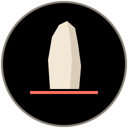
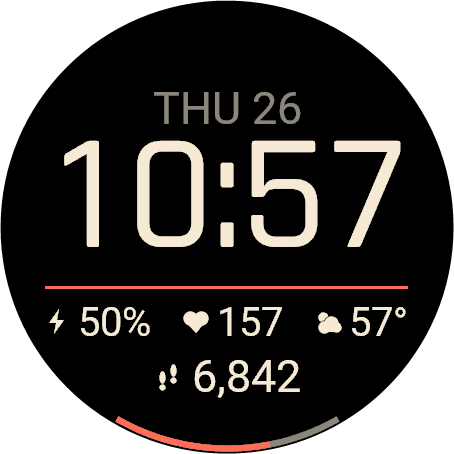
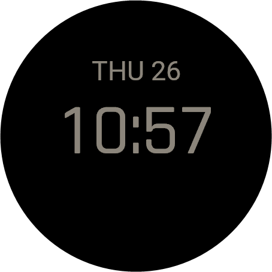

<p align="center">
  
</p>

<h1 align="center">Menhir</h1>

<p align="center">
  A plain, big-numeral Garmin Connect IQ watch face for the fēnix 8 Pro.
</p>

<p align="center">
  
  &nbsp;&nbsp;
  
</p>
<p align="center"><sub>Normal and always-on, from the Connect IQ simulator (454×454)</sub></p>

## What it shows

- The **date** on top, a large ivory **HH:MM**, and a thin coral rule under the time.
- Three values under the rule: **battery**, **heart rate** and **weather** by default.
- **Steps** at the bottom, with a step-goal bar that follows the edge of the dial. A straight bar is also available.
- **Always-on mode** (AMOLED): just a dim date and time. They move a few pixels every minute to avoid burn-in.

Colors: ivory `#F2E8D5`, dim `#8A8478`, coral `#FF6F5E` on black.

## Settings

Change these on the watch itself, through the watch face options (hold **MENU**, then **Watch Face**). Selecting an item steps it to the next option.

| Setting | Options |
|---|---|
| Top / Left / Middle / Right / Bottom field | None, Date, Battery, Steps, Heart rate, Calories, Distance, Floors, Notifications, Weather |
| Top / Left / Middle / Right / Bottom color | Ivory, Dim, Coral, White, Red, Orange, Yellow, Green, Blue, Purple |
| Divider color | Same colors as above (Coral by default) |
| Step bar | Curved, Straight |
| Step bar color | Same colors as above (Coral by default) |
| Icons | On, Off |

The step bar only appears when the bottom field is set to Steps. The weather icon follows the current conditions, and shows a moon after sunset.

These settings live on the watch, not in the Connect IQ phone app. The phone app only shows settings for apps installed from the store, and this face is sideloaded.

## Building

You need the [Connect IQ SDK](https://developer.garmin.com/connect-iq/sdk/) (built with 9.3.0) and a developer key.

```sh
monkeyc -f monkey.jungle -d fenix8pro47mm -o bin/Menhir.prg -y <path-to-developer_key.der> -w
```

`fenix8pro47mm` is Garmin's profile for the 47mm, 51mm and MicroLED fēnix 8 Pro. To try it in the simulator:

```sh
connectiq            # start the simulator
monkeydo bin/Menhir.prg fenix8pro47mm
```

## Installing

Connect the watch over USB and copy `bin/Menhir.prg` to `GARMIN/Apps` on the watch. Then pick Menhir from the watch face list.

## Credits

The layout is inspired by the [Bezel Monolith](https://apps.garmin.com/en-US/apps/84d8c32c-3d20-4586-aa24-c06524e82e3d) face in the Connect IQ store. It was copied by eye from the store screenshots, and none of its code is used here.
